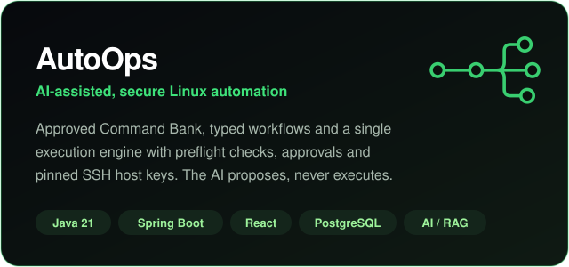
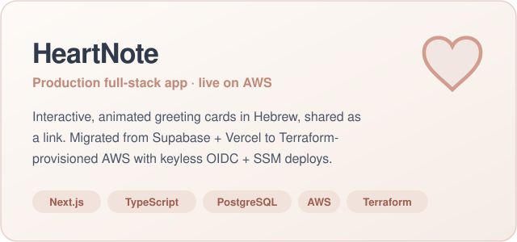
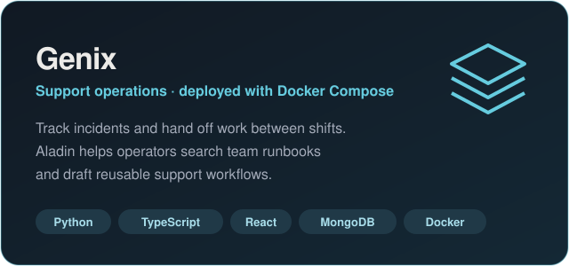

 

### Computer Science student who builds, secures and ships production software.

I've spent 5+ years in IT: first in network operations in the IDF, then in system administration and IT support engineering at Elbit Systems. Now I write the software side. My projects are backend-heavy,
security-conscious and deployed. One runs in production on AWS; the other automates Linux servers with an LLM
that is only allowed to *propose* actions.

| | |
| --- | --- |
| 🎓 **Education** | B.Sc. Computer Science, 2nd year, The Academic College of Tel Aviv-Yafo (expected 2029) |
| 🎯 **Looking for** | Student / junior roles: **Software Engineer · AI Engineer · Backend / Full-Stack · DevOps / Cloud** |
| 💼 **Experience** | IT Support Engineer, Elbit Systems (2025–2026) · System Administrator, Elbit Systems (2023–2024) · IT & Network Support, IDF C4I Corps (2020–2023) |
| 🚀 **Shipped** | [HeartNote](https://github.com/ilayadmoni/HeartNote), live at [heartnote.co.il](https://www.heartnote.co.il) · [AutoOps](https://github.com/ilayadmoni/AutoOps), a Spring Boot + React automation platform |
| 🗣️ **Languages** | Hebrew (native) · English (fluent) |

---

## Featured projects

<table>
<tr>
<td width="33%" valign="top">

</td>
<td width="33%" valign="top">

</td>
<td width="33%" valign="top"></td>
</tr>
<tr>
<td valign="top">

**The problem:** ops teams manage RHEL fleets by SSH-ing in and pasting commands, with no review, no
approval and no record of what ran.

**What I built:** a Spring Boot modular monolith (156 Java classes, 17 Flyway migrations) and a
React 19 / TypeScript SPA in English and Hebrew.

- **One execution engine** for all runs: preflight → approval gate → parallel run → aggregate,
  with stop, retry and restart recovery. [Design doc](https://github.com/ilayadmoni/AutoOps/blob/main/docs/EXECUTION_ENGINE.md)
- **Security model:** pinned SSH host keys, AES-256-GCM encrypted credentials, and rotating refresh
  tokens with reuse detection. [Security doc](https://github.com/ilayadmoni/AutoOps/blob/main/docs/SECURITY.md)
- **LLM assistant with guardrails:** native tool calling with 11 read / validate / propose-only tools.
  Every proposal is re-validated in Java, and the AI never executes anything. [AI doc](https://github.com/ilayadmoni/AutoOps/blob/main/docs/AI.md)
- **Hybrid retrieval:** command search combines pgvector cosine similarity (HNSW index) with lexical
  scoring. [`CommandRetrievalService`](https://github.com/ilayadmoni/AutoOps/blob/main/backend/src/main/java/com/autoops/command/retrieval/CommandRetrievalService.java)
- **CI:** GitHub Actions runs the JUnit suite and the frontend type-check and build. [Workflow](https://github.com/ilayadmoni/AutoOps/blob/main/.github/workflows/ci.yml)

`Java 21` `Spring Boot 3.5` `Spring Security` `PostgreSQL + pgvector` `React 19` `TypeScript` `MinIO` `Docker`

</td>
<td valign="top">

**The problem:** a Hebrew-first platform where people create animated, interactive greeting cards
and share them as a link. The recipient needs no app or account.

**What I built:** the product end to end, from UI to infrastructure. It's **live at
[heartnote.co.il](https://www.heartnote.co.il)** with 20+ interactive templates.

- **Platform migration:** moved a live app from Supabase + Vercel to AWS, rewriting auth on Auth.js v5
  and data access on Prisma. bcrypt hashes carried over, so no user had to reset a password. [Migration notes](https://github.com/ilayadmoni/HeartNote#migration-history)
- **Infrastructure as code:** Terraform for EC2, a private RDS PostgreSQL instance with no public
  route, and scoped IAM roles. [`infra/aws`](https://github.com/ilayadmoni/HeartNote/tree/main/infra/aws)
- **Gated CI/CD:** type-check, lint, Vitest and a production build must pass before deploy.
  AWS access uses GitHub OIDC, with no stored keys. [Workflow](https://github.com/ilayadmoni/HeartNote/blob/main/.github/workflows/ci.yml)
- **Application security:** CSRF origin checks, an auth wrapper on every Server Action, Redis rate
  limiting and a PII-masking logger. [Security table](https://github.com/ilayadmoni/HeartNote#security)
- **Production debugging:** fixed OAuth behind a reverse proxy, a TLS name mismatch and out-of-memory
  builds on a 1 GB instance.

`Next.js 14` `TypeScript` `Prisma` `PostgreSQL` `AWS EC2 + RDS` `Terraform` `Docker` `GitHub Actions`

</td>
<td valign="top">

**The problem:** during a shift handoff, operators need to see which incidents are open, who owns them, and which runbook to follow.

**What I built:** a self-hosted support workspace that brings CRM incidents, team tasks, and searchable runbooks into one dashboard.

- **Live operations:** Socket.IO delivers task updates to the Kanban board and shift dashboard. Operators can switch between English and Hebrew.
- **Knowledge search:** a Python worker indexes uploaded documents. Aladin combines keyword and embedding search to find runbooks from an error message or a description of the issue.
- **Reusable workflows:** operators can ask Aladin to draft a procedure, review its steps in React Flow, and save it for the next shift.
- **Docker deployment:** Docker Compose runs five services: the Nginx frontend, Flask API, ingestion worker, MongoDB database, and SeaweedFS file store. Images can be exported for disconnected deployments.

`React 19` `TypeScript` `Tailwind CSS` `Python / Flask` `Socket.IO` `MongoDB` `SeaweedFS` `Nginx` `Docker Compose`

</td>
</tr>
</table>

## Where to look, by role

| If you're hiring for… | Start here |
| --- | --- |
| **Backend** | AutoOps [execution engine](https://github.com/ilayadmoni/AutoOps/blob/main/docs/EXECUTION_ENGINE.md), [REST API](https://github.com/ilayadmoni/AutoOps/blob/main/docs/API.md) and [schema & migrations](https://github.com/ilayadmoni/AutoOps/blob/main/docs/DATABASE.md) |
| **AI Engineering** | AutoOps [LLM tool calling with server-side validation](https://github.com/ilayadmoni/AutoOps/blob/main/docs/AI.md) and [hybrid pgvector retrieval](https://github.com/ilayadmoni/AutoOps/blob/main/backend/src/main/java/com/autoops/command/retrieval/CommandRetrievalService.java) |
| **Full-Stack** | HeartNote: Next.js App Router, typed Server Actions and Prisma ([architecture](https://github.com/ilayadmoni/HeartNote#architecture)) · AutoOps bilingual React SPA ([frontend doc](https://github.com/ilayadmoni/AutoOps/blob/main/docs/FRONTEND.md)) |
| **DevOps / Cloud** | HeartNote [Terraform on AWS](https://github.com/ilayadmoni/HeartNote/tree/main/infra/aws) and [CI/CD with OIDC](https://github.com/ilayadmoni/HeartNote#cicd-pipeline) · AutoOps [Docker Compose deployment](https://github.com/ilayadmoni/AutoOps/blob/main/docs/DEPLOYMENT.md) |

## Experience

**IT Support Engineer**, Elbit Systems · *2025–2026*

**System Administrator**, Elbit Systems · *2023–2024*
- Wrote PowerShell and PowerCLI automation scripts to streamline operational processes.
- Managed VMware infrastructure and supported Linux / RHEL environments.

**IT & Network Support, Sergeant**, IDF C4I Corps · *2020 – 2023*
- Ran network operations and kept 200+ endpoints operationally ready.

## Tech stack

| | |
| --- | --- |
| **Languages** | Java · TypeScript · Python · SQL · PowerShell |
| **Backend** | Spring Boot · Spring Security · JPA / Flyway · Next.js Server Actions · Flask · REST APIs |
| **Frontend** | React · Next.js · TanStack Query · Tailwind CSS · i18n / RTL |
| **Data** | PostgreSQL · pgvector · Prisma · MongoDB · MinIO / S3 |
| **AI** | LLM tool calling (OpenAI-compatible APIs) · embeddings & vector search · Claude Code · GitHub Copilot |
| **Cloud & DevOps** | AWS (EC2, RDS, IAM) · Terraform · Docker · GitHub Actions · Kubernetes / OpenShift · Nginx · RHEL · VMware · Git |

## Education

**B.Sc. Computer Science**, The Academic College of Tel Aviv-Yafo · 2nd year · expected graduation 2029 
Introduction to Computer Science (Python): 97

---

**Open to student and junior Software Engineering roles.** 
Reach me at [ilayadmoni9@gmail.com](mailto:ilayadmoni9@gmail.com) or on [LinkedIn](http://www.linkedin.com/in/ilay-admoni-11010145252572577252).

