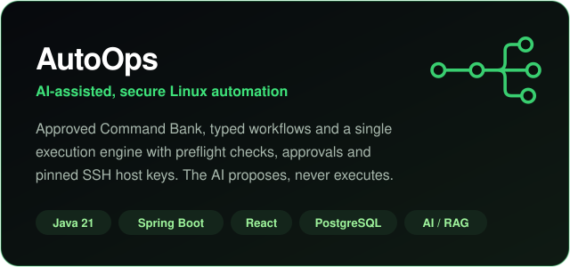
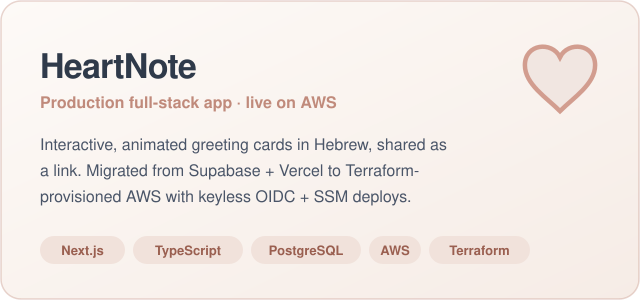

 

## 👋 About me

I'm a **second-year B.Sc. Computer Science student** at The Academic College of Tel Aviv-Yafo with hands-on
experience in **software development and production systems**.

Before that I spent years on the infrastructure side as a System Administrator and in the IDF C4I Corps. That
background shows up in what I build: software that is **secure by default, observable, and actually deployed**.

- 🔭 Building **[AutoOps](https://github.com/ilayadmoni/AutoOps)**, an AI-assisted platform for secure Linux automation
- 🚀 Running **[HeartNote](https://github.com/ilayadmoni/HeartNote)** in production on AWS at [heartnote.co.il](https://www.heartnote.co.il)
- 🎯 **Looking for a student Software Engineering position**
- 🗣️ Hebrew (native) · English (fluent)

## 🚀 Featured projects

<table>
<tr>
<td width="50%">

</td>
<td width="50%">

</td>
</tr>
<tr>
<td valign="top">

**[AutoOps](https://github.com/ilayadmoni/AutoOps)** lets ops teams run approved commands and multi-step
workflows across RHEL fleets, with server-side risk classification, approval gates, pinned SSH host keys,
AES-256-GCM-encrypted credentials and a full audit trail. An AI assistant built on native tool calling
drafts workflows and explains failures, but it can only *propose*.

`Java 21` `Spring Boot 3.5` `React 19` `TypeScript` `PostgreSQL + pgvector` `MinIO` `Docker`

</td>
<td valign="top">

**[HeartNote](https://github.com/ilayadmoni/HeartNote)** is a Hebrew-first platform for interactive
greeting cards, **live in production**. I migrated it from Supabase + Vercel to Terraform-provisioned AWS
(EC2 + private RDS) with a keyless GitHub Actions → OIDC → SSM pipeline. No user had to reset a password.

`Next.js 14` `TypeScript` `Prisma` `PostgreSQL` `AWS` `Terraform` `Docker`

&nbsp;&nbsp;🌐 **[heartnote.co.il](https://www.heartnote.co.il)**

</td>
</tr>
</table>

## 💼 Experience

| | Role | When |
| :---: | --- | --- |
| 🖥️ | **System Administrator** · Elbit Systems Wrote PowerShell and PowerCLI automation scripts to streamline operational processes. Managed VMware infrastructure and supported Linux/RHEL environments. | 08/2023 – 11/2025 |
| 🎖️ | **IT & Network Support, Sergeant** · IDF C4I Corps Ran network operations and kept 200+ endpoints operationally ready. | 2020 – 2023 |

## 🛠️ Tech stack

<b>Languages</b> 

<b>Frontend & backend</b> 

<b>Data</b> 

<b>Cloud & DevOps</b> 

<b>AI development</b> 

## 🎓 Education

**B.Sc. Computer Science**, The Academic College of Tel Aviv-Yafo · 2nd year · expected graduation 2029 
Introduction to Computer Science (Python): **97**

---

### 📫 Let's talk

I'm looking for a **student Software Engineering position**. The fastest way to reach me is
**[ilayadmoni9@gmail.com](mailto:ilayadmoni9@gmail.com)** or **[LinkedIn](http://www.linkedin.com/in/ilay-admoni-11010145252572577252)**.

